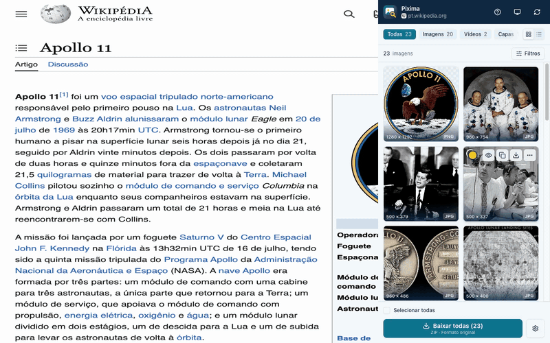
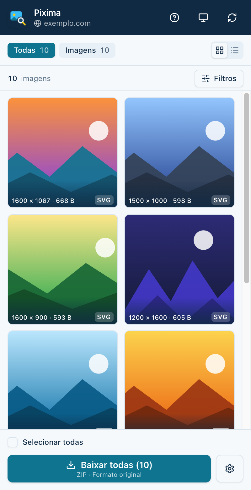
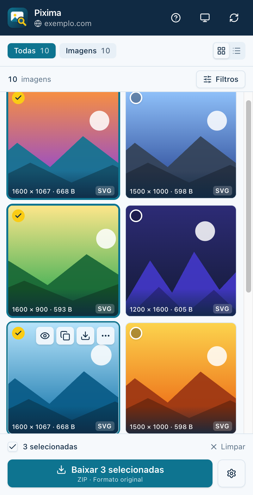
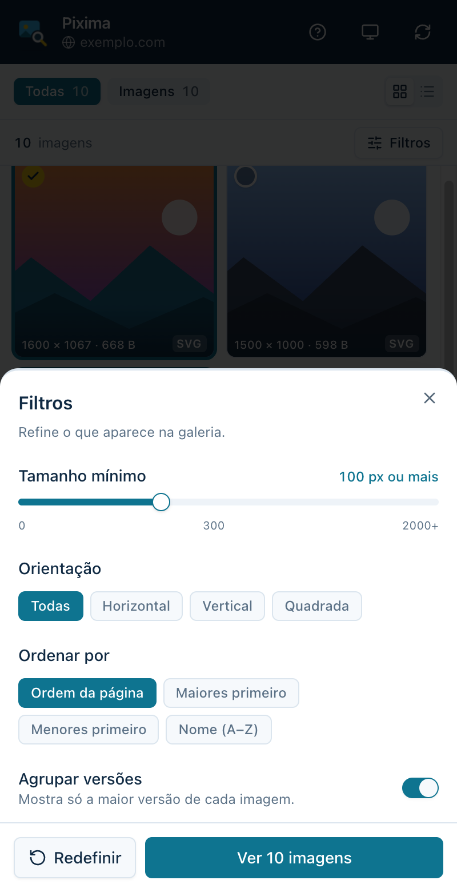
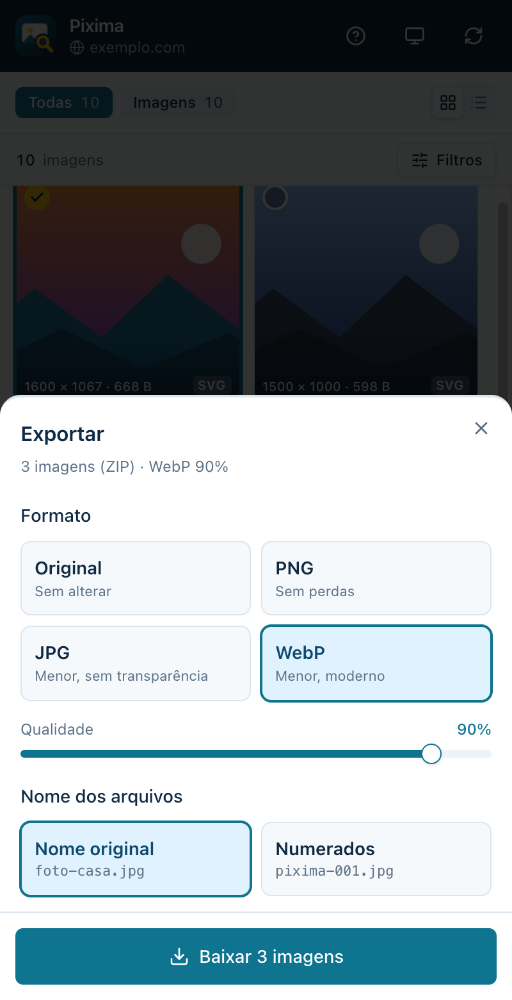
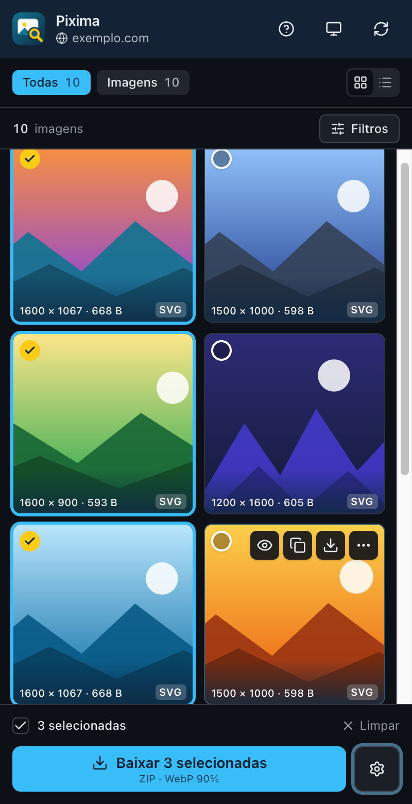

# Pixima

[](LICENSE)
[](#instalação)
[](https://rodrigueskaua.github.io/pixima/)

**Todas as imagens de qualquer site num só painel. Copie, converta e baixe em segundos.**

Chega de clicar com o botão direito, imagem por imagem. O Pixima abre um painel ao lado do site e mostra **tudo o que a página tem: fotos, fundos, SVGs e até o que só carrega depois**, já sem repetições, anúncios e rastreadores.

Escolha o que quiser, **baixe tudo em um ZIP e converta para PNG, JPG ou WebP no mesmo clique**.

Tudo acontece no seu navegador: sem conta, sem rastreamento e **nenhuma imagem passa por servidor**.

<div align="center">
  
</div>

Capturas feitas na Wikipédia, no artigo sobre a Apollo 11, com imagens de domínio público da NASA. O texto da Wikipédia é licenciado sob [CC BY-SA 4.0](https://creativecommons.org/licenses/by-sa/4.0/deed.pt-br).

<details>
<summary>Ver as telas em tamanho original</summary>

<br>

<div align="center">
  
  
  
  
  
</div>

</details>

## Features

- Veja todas as imagens da página num painel ao lado, sem sair do site
- Acha também as que ficam escondidas: fundos, SVGs, capas de vídeo e imagens que o site carrega depois
- Mostra só a melhor versão de cada imagem, sem repetir miniatura e tamanho médio
- Deixa de fora anúncios, rastreadores e itens de interface, como logos e ícones
- Filtre por tipo, tamanho, formato e orientação, e ordene como preferir
- Selecione várias de uma vez (Shift para um intervalo) e amplie para conferir antes de baixar
- Escolha uma imagem direto na página: toque em "Escolher na página", passe o mouse e clique nela
- Copie a imagem ou o link com um clique
- Baixe uma imagem ou várias de uma vez em um ZIP
- Converta para PNG, JPG ou WebP ao baixar, escolhendo a qualidade e se os arquivos mantêm o nome original ou são numerados
- Tema claro, escuro ou automático
- Um tour rápido mostra o básico no primeiro uso
- Privado: tudo acontece no seu navegador, sem conta, sem rastreamento e sem enviar nada para servidores

## Como usar

1. Abra qualquer site e clique no ícone do Pixima na barra do navegador
2. Toque nas imagens que quiser, ou deixe nenhuma marcada para pegar todas
3. Clique em **Baixar**. Para mudar o formato ou o nome dos arquivos, use a engrenagem ao lado

## Instalação

O Pixima ainda não está nas lojas. Para usar, gere o build e carregue no navegador:

```sh
git clone https://github.com/rodrigueskaua/pixima.git
cd pixima
npm install
npm run build
npm run build:firefox
```

- **Chrome, Edge e Brave:** abra `chrome://extensions`, ative o modo do desenvolvedor, clique em "Carregar sem compactação" e escolha a pasta `.output/chrome-mv3`.
- **Firefox:** abra `about:debugging#/runtime/this-firefox`, clique em "Carregar extensão temporária" e escolha o arquivo `.output/firefox-mv3/manifest.json`. Depois, em `about:addons`, abra o Pixima, vá em "Permissões" e ative o acesso a todos os sites.

O navegador não permite extensões em páginas internas, na loja de extensões e em alguns arquivos locais, e o Pixima não consegue escanear essas páginas.

## Stack

<a href="https://wxt.dev/" target="_blank">
  
</a>
<a href="https://vuejs.org/" target="_blank">
  
</a>
<a href="https://www.typescriptlang.org/" target="_blank">
  
</a>
<a href="https://tailwindcss.com/" target="_blank">
  
</a>
<a href="https://vite.dev/" target="_blank">
  
</a>
<a href="https://www.shadcn-vue.com/" target="_blank">
  
</a>

### Bibliotecas complementares

[Reka UI](https://reka-ui.com/) <br>
[Lucide Icons](https://lucide.dev/) <br>
[VueUse](https://vueuse.org/) <br>
[fflate](https://github.com/101arrowz/fflate) <br>
[driver.js](https://driverjs.com/) <br>
[vue-sonner](https://vue-sonner.vercel.app/) <br>
[Inter](https://rsms.me/inter/) <br>

## Roadmap

Em andamento:

- [ ] Publicar na Chrome Web Store e no Firefox Add-ons

Próximos:

- [ ] Menu de botão direito na imagem
- [ ] Redimensionar ao exportar
- [ ] Vídeos e áudios
- [ ] Testes automatizados
- [ ] CI no GitHub Actions (tipos, build e pacote das extensões)

## Desenvolvimento

### Pré-requisitos

- Node.js >= 20.19
- npm >= 10

### Instalação

```sh
git clone https://github.com/rodrigueskaua/pixima.git
cd pixima
npm install
```

### Rodar em modo desenvolvimento

```sh
npm run dev
npm run dev:firefox
```

O primeiro abre um Chrome e o segundo um Firefox, ambos com a extensão carregada e recarregando a cada mudança no código.

### Gerar os pacotes

```sh
npm run build
npm run build:firefox
npm run zip
npm run zip:firefox
```

Os builds ficam em `.output/chrome-mv3` e `.output/firefox-mv3`, e os `.zip` para as lojas em `.output/`.

### Site

O [site do Pixima](https://rodrigueskaua.github.io/pixima/) fica na pasta `site/`, feito com Nuxt e Tailwind, e é publicado no GitHub Pages.

```sh
cd site
npm install
npm run dev
npm run deploy
```

O `npm run deploy` gera o site estático e envia o resultado para a branch `gh-pages`.
